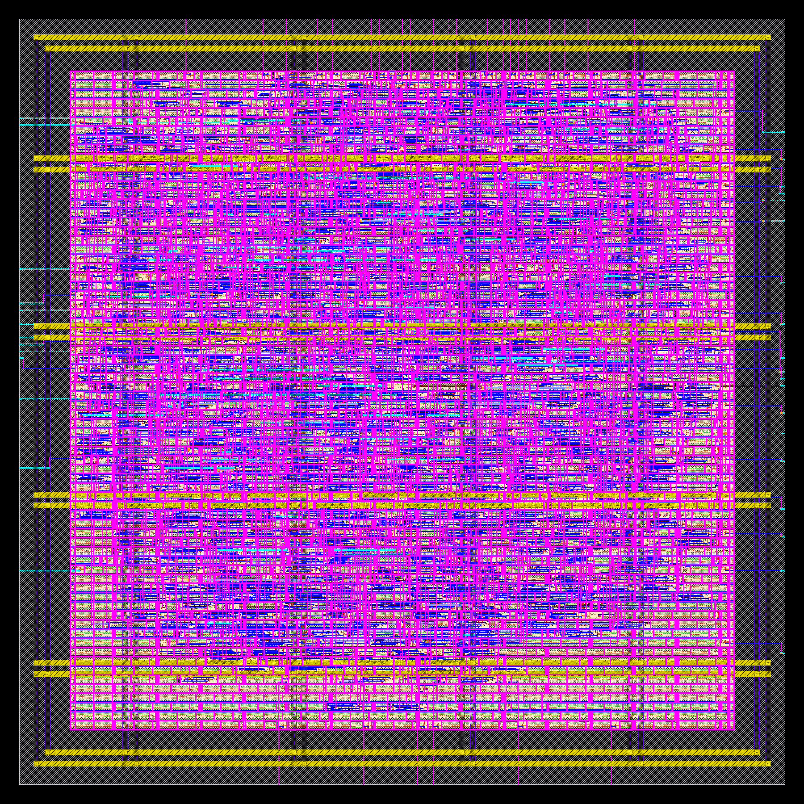
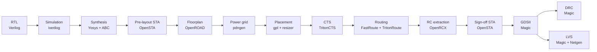
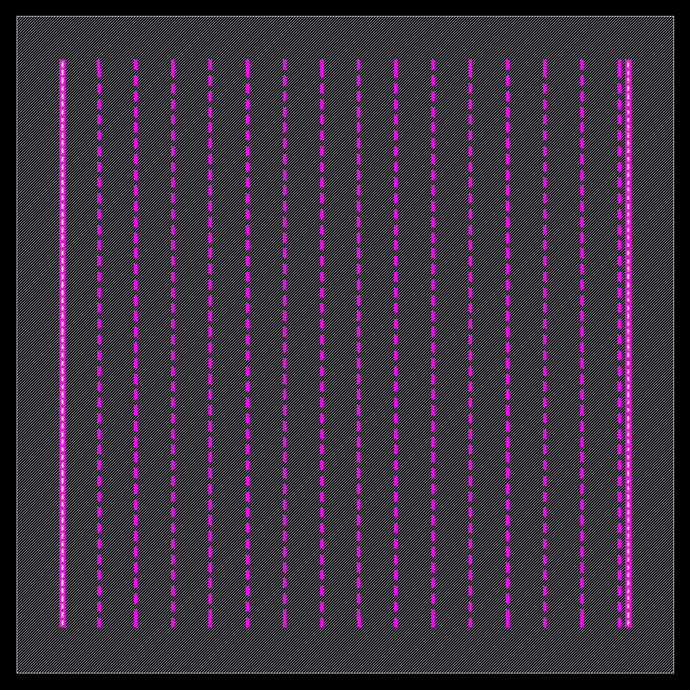
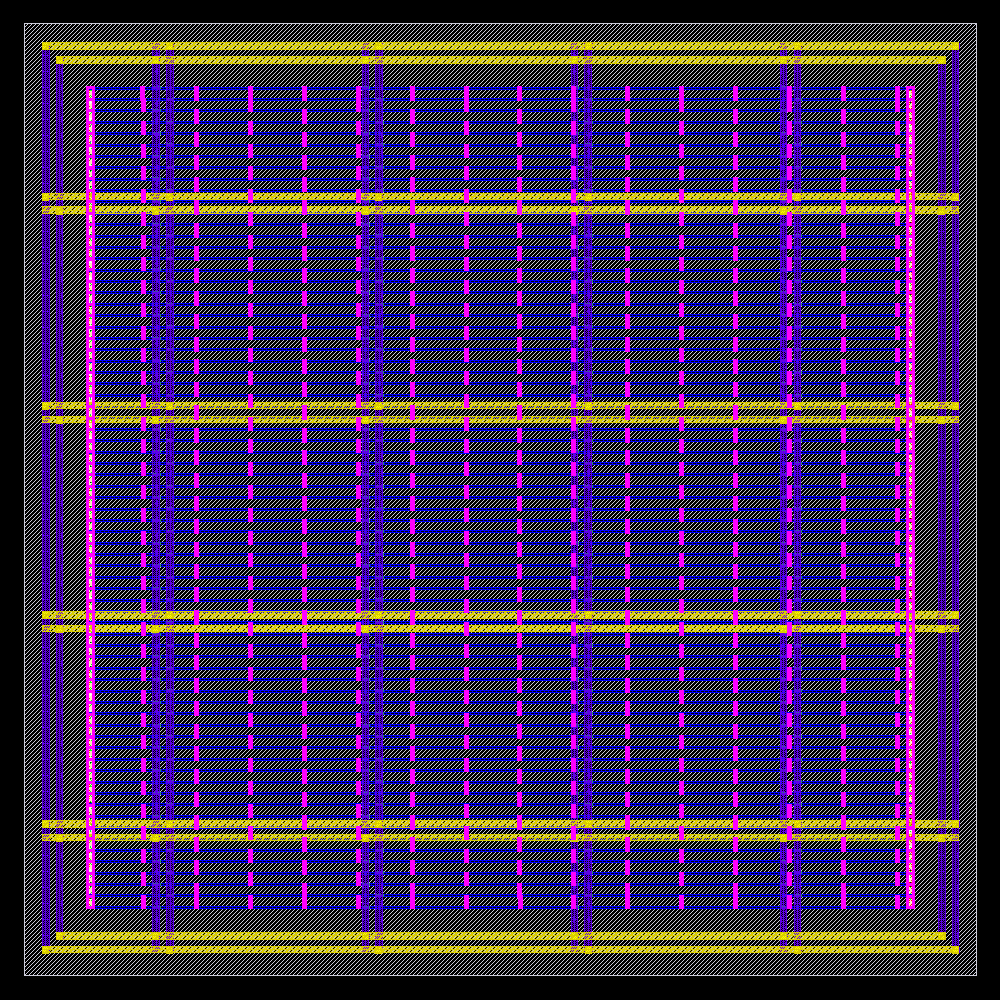
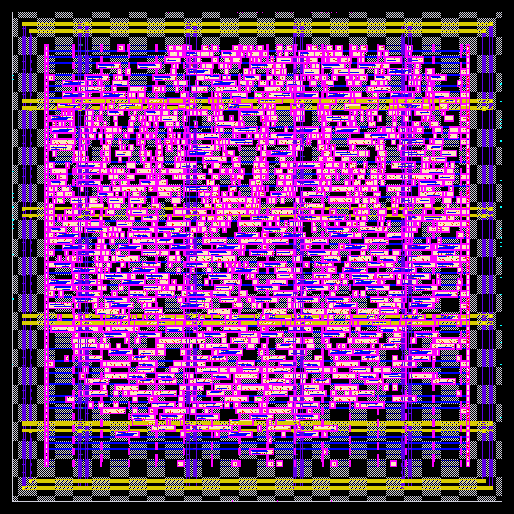
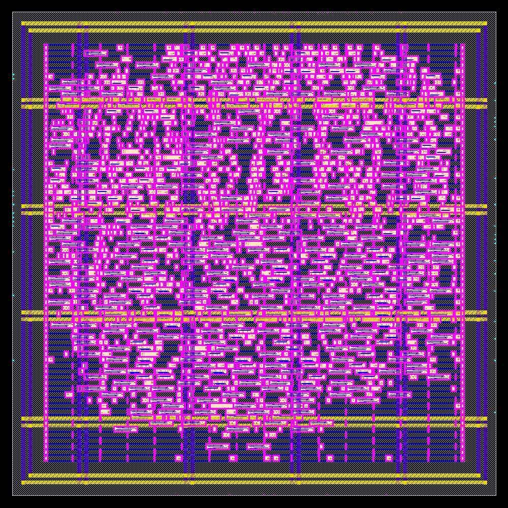
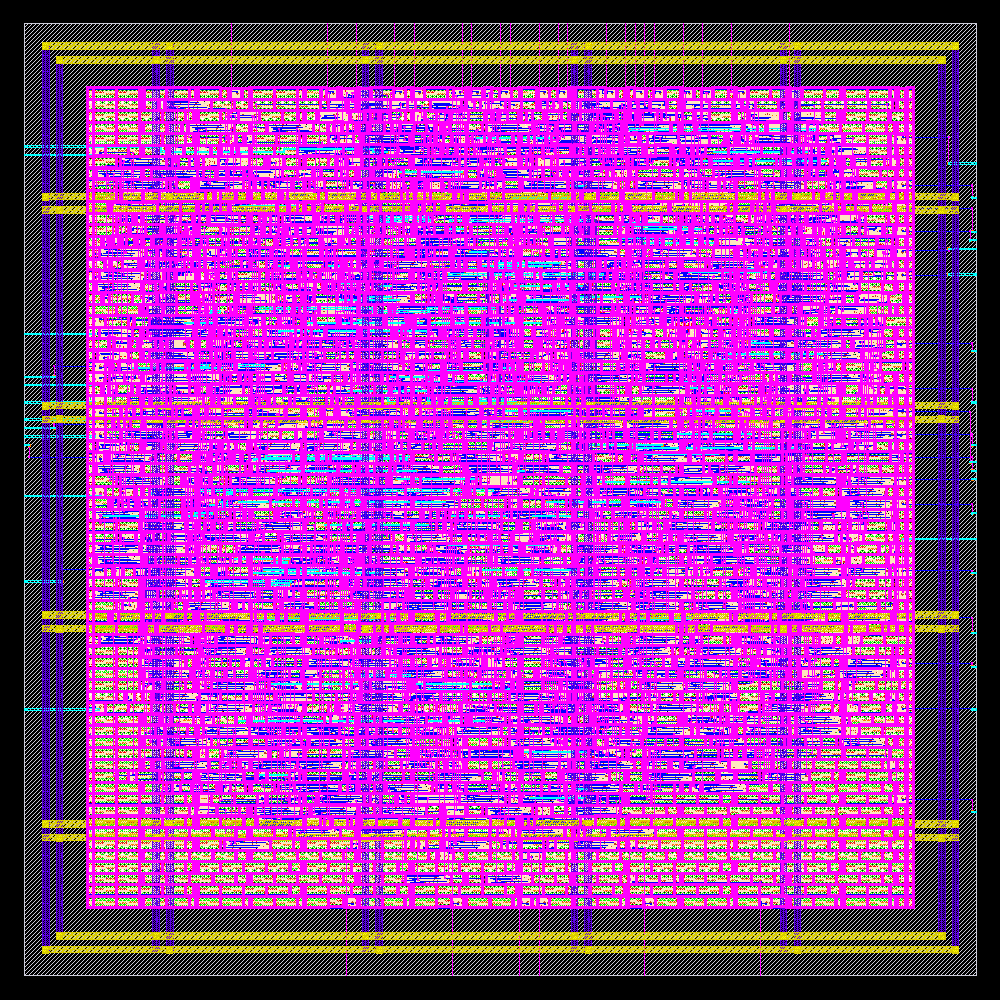
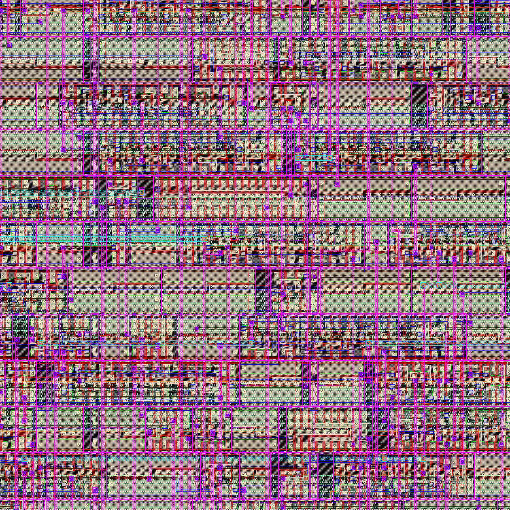

<div align="center">

# RTL → GDSII : 16-bit Pipelined SimpleCPU in SkyWater 130 nm

**A complete open-source ASIC flow done by hand, one tool at a time —<br>from Verilog RTL to a DRC- and LVS-clean GDSII layout.**


-brightgreen)




*Final GDSII of `simple_cpu_v4`: 227.7 × 227.7 µm, 1 522 logic cells, 322 flip-flops, 46 mm of routing*

</div>

---

## Highlights

| | |
|---|---|
| **Design** | 5-stage pipelined 16-bit CPU (IF → ID → EX → MA → WB), 8 registers, hazard detection with stalls |
| **Technology** | SkyWater SKY130A, `sky130_fd_sc_hd` standard cells, 1.8 V |
| **Die / core** | 227.7 × 227.7 µm (0.052 mm²) / 197.3 × 195.8 µm, 49 % utilisation |
| **Clock** | 50 MHz — worst setup slack **+4.54 ns** at the slow corner (≈ 64 MHz possible) |
| **Sign-off** | Setup & hold MET in **ss / tt / ff** with extracted RC · **0** slew/cap/fanout violations · **DRC 0** · **LVS match** · **antenna 0** |
| **Power** | 1.68 mW (typical corner, 50 MHz) |
| **Flow** | No push-button flow: every step is a separate, commented script run inside Docker |

---

## The flow



| # | Step | Tool | Script | Key result |
|---|------|------|--------|-----------|
| 01 | RTL simulation | Icarus Verilog | [`01_sim.sh`](flow/01_sim.sh) | self-checking test **PASSED** |
| 02 | Logic synthesis | Yosys + ABC | [`02_synth.tcl`](flow/02_synth.tcl) | 1 211 cells, 15 636 µm², 322 FFs |
| 03 | Pre-layout STA | OpenSTA | [`03_sta_synth.tcl`](flow/03_sta_synth.tcl) | setup +12.49 ns, hold +0.18 ns |
| 04 | Floorplan | OpenROAD | [`04_floorplan.tcl`](flow/04_floorplan.tcl) | 72 rows, 555 tap + 144 endcap cells |
| 05 | Power network | OpenROAD pdngen | [`05_pdn.tcl`](flow/05_pdn.tcl) | met4/met5 ring + straps, met1 rails, all connected |
| 06 | Placement | OpenROAD | [`06_place.tcl`](flow/06_place.tcl) | 581 slew violations → **0** after repair |
| 07 | Clock tree | OpenROAD TritonCTS | [`07_cts.tcl`](flow/07_cts.tcl) | 48 clock buffers, 3 levels, skew 0.27 ns, 73 hold fixes |
| 08 | Routing | FastRoute + TritonRoute | [`08_route.tcl`](flow/08_route.tcl) | 950 → … → **0** DRC, 46.2 mm wire, 0 antenna |
| 09 | Extraction + sign-off STA | OpenRCX + OpenSTA | [`09_rcx.tcl`](flow/09_rcx.tcl), [`09_sta_signoff.tcl`](flow/09_sta_signoff.tcl) | all corners MET, 0 DRV |
| 10 | GDSII stream-out | Magic | [`10_gds.tcl`](flow/10_gds.tcl) | `simple_cpu_v4.gds` |
| 11 | DRC | Magic (full sky130 deck) | [`11_drc.tcl`](flow/11_drc.tcl) | **0 violations** |
| 12 | LVS | Magic + Netgen | [`12_extract.tcl`](flow/12_extract.tcl), [`12_lvs_netgen.tcl`](flow/12_lvs_netgen.tcl) | **Circuits match uniquely** |
| 13 | Layout pictures | KLayout | [`13_render.py`](flow/13_render.py), [`14_stage_images.py`](flow/14_stage_images.py) | images below |

---

## Layout, stage by stage

<table>
<tr>
<td align="center"><br><b>04 Floorplan</b><br><sub>rows, well-tap columns, endcaps</sub></td>
<td align="center"><br><b>05 Power grid</b><br><sub>met4/met5 ring + straps, met1 rails</sub></td>
<td align="center"><br><b>06 Placement</b><br><sub>cells legalised on the rows</sub></td>
</tr>
<tr>
<td align="center"><br><b>07 Clock tree</b><br><sub>+48 clock buffers, +73 hold cells</sub></td>
<td align="center"><br><b>08 Routed</b><br><sub>met1–met5 signal routing</sub></td>
<td align="center"><br><b>Final GDS – 30 µm zoom</b><br><sub>transistor-level std cells</sub></td>
</tr>
</table>

---

## Sign-off results

**Static timing with extracted parasitics** ([`reports/09_sta_signoff.rpt`](reports/09_sta_signoff.rpt))

| Corner | Cells | RC | Setup WNS | Hold WNS |
|---|---|---|---|---|
| slow | ss 100 °C 1.60 V | max | **+4.536 ns** | +0.853 ns |
| typical | tt 25 °C 1.80 V | nom | +12.747 ns | +0.313 ns |
| fast | ff −40 °C 1.95 V | min | +14.309 ns | **+0.105 ns** |

TNS 0 / 0 · worst slew 0.62 ns (limit 0.75) · clock skew 0.29 ns · power 1.68 mW
(flip-flops 49 %, clock tree 34 %, logic 17 %)

**Physical verification**

| Check | Tool | Result | Report |
|---|---|---|---|
| Detailed-route DRC | TritonRoute | 0 | [`08_route_drc.rpt`](reports/08_route_drc.rpt) |
| Antenna | OpenROAD | 0 nets / 0 pins | [`08_route_antenna.rpt`](reports/08_route_antenna.rpt) |
| Full DRC on GDS | Magic `drc(full)` | **0** | [`11_drc.rpt`](reports/11_drc.rpt) |
| LVS | Netgen | **match** — 1 527 devices, 1 542 nets on both sides | [`12_lvs.rpt`](reports/12_lvs.rpt) |

---

## Real problems found and fixed

Running each tool by hand exposed issues a push-button flow hides. Each one is documented in
[`docs/FLOW_NOTES.txt`](docs/FLOW_NOTES.txt) together with the log line that revealed it.

| Stage | Symptom | Root cause | Fix |
|---|---|---|---|
| Synthesis | `Wire mem_addr is used but has no driver` | Yosys did not know the cell pin directions | `read_liberty -lib` before reading RTL |
| Synthesis | power-gating (`lpflow_*`) and clock inverters used in logic | no dont-use list | PDK `synth_excluded.cells` → `-dont_use` |
| Placement | all 58 IO buffers were `clkdlybuf4s15` delay cells | `buffer_ports` picked a delay cell | `-buffer_cell sky130_fd_sc_hd__buf_4` |
| Routing | **~50 max-slew violations at sign-off** (worst 0.96 ns) although placement said 0.67 ns | wire-RC estimate ~40 % optimistic vs. OpenRCX | post-global-route `repair_design -slew_margin 40` → worst 0.62 ns |
| GDS | `DEF read: 11 077 errors – via M1M2_PR unknown` (a GDS was still written!) | tech LEF with the via definitions not loaded in Magic | `lef read <tech.lef>` before `def read` |
| LVS | `Top level cell failed pin matching`, 1 542 vs 2 806 nets | 12 104 supply pins of cells added after the PDN step never connected | `global_connect` after the last cell insertion |
| Tooling | `invalid command sta::find_corner`, `-bottom_routing_layer is deprecated` | newer OpenROAD (26Q3) API | `sta::find_scene`, `set_routing_layers` |

A LibreLane (OpenLane 2) push-button run of the same RTL was used as a reference — it finished
with **229 slew violations** caused by the same RC-estimate gap; the manual flow closes them.

---

## Repository layout

```
RTL_to_GDS/
├── RTL/Simplecpu.v              5-stage pipelined SimpleCPU v4 (module simple_cpu_v4)
├── tb/simple_cpu_v4_tb.v        self-checking testbench + 4K x 16 memory model
├── flow/                        one script per step (+ env.sh, or_common.tcl, constraints/*.sdc)
├── reports/                     every log and report, incl. the failing first tries (*_try1)
├── results/
│   ├── 02_synth/                gate-level netlist
│   ├── 04_to_08_pnr/            DEF after each stage, routed netlists (with / without power)
│   ├── 09_spef/                 extracted parasitics (min / nom / max)
│   ├── 10_gds/                  ★ final GDSII
│   └── 12_lvs/                  layout-extracted SPICE netlist
└── docs/
    ├── FLOW_NOTES.txt           step-by-step lab notebook (commands, results, debugging)
    └── images/                  layout pictures
```

---

## The CPU

| Feature | |
|---|---|
| Data / instruction width | 16 bit / 16 bit fixed |
| Address space | 12 bit (4 K words), single-port memory for code **and** data (von Neumann) |
| Registers | 8 × 16 bit (RA … RH, RH = link register) |
| Pipeline | IF → ID → EX → MA → WB |
| Hazards | RAW: stall in ID (no forwarding) · structural: LOAD/STORE stall fetch · control: branch resolved in EX |
| ISA | MOVE/ADD/SUB/AND (imm & reg), LOAD, STORE, JUMP, JUMPZ, JUMPNZ, JAL, JR |

The testbench program sums 10 + 9 + … + 1 in a loop, stores and reloads the result, calls a
subroutine with `JAL`/`JR` and tests `JUMPZ` — all results are checked automatically.

---

## Run it yourself

Everything runs in the [IIC-OSIC-TOOLS](https://github.com/iic-jku/IIC-OSIC-TOOLS) Docker image
(Yosys, OpenROAD, OpenSTA, Magic, Netgen, KLayout and the SKY130A PDK are included).

```bash
git clone https://github.com/pratyush21-ux/Vlsi.git
cd Vlsi/RTL_to_GDS
docker run --rm -it -v "$PWD:/foss/designs/RTL_to_GDS" -w /foss/designs/RTL_to_GDS \
       hpretl/iic-osic-tools:latest --skip bash
```

Inside the container, run the steps in order:

```bash
bash flow/01_sim.sh                 # RTL simulation
bash flow/02_synth.sh               # Yosys synthesis
bash flow/03_sta_synth.sh           # OpenSTA, ideal wires
bash flow/run_or.sh 04_floorplan    # OpenROAD steps ...
bash flow/run_or.sh 05_pdn
bash flow/run_or.sh 06_place
bash flow/run_or.sh 07_cts
bash flow/run_or.sh 08_route
bash flow/09_signoff.sh             # OpenRCX + OpenSTA sign-off
bash flow/10_gds.sh                 # Magic GDS
bash flow/11_drc.sh                 # Magic DRC
bash flow/12_lvs.sh                 # Magic extract + Netgen LVS
bash flow/13_render.sh              # pictures
```

Re-running writes fresh outputs to `results/` and `reports/`. View the layout with
`klayout results/10_gds/simple_cpu_v4.gds -l $PDK_ROOT/sky130A/libs.tech/klayout/tech/sky130A.lyp`
(press `*` to show all hierarchy levels).

---

<div align="center">

**Pratyush Kumar Sahu** · ECE, Silicon University Bhubaneswar · [sahukumarpratyush2004@gmail.com](mailto:sahukumarpratyush2004@gmail.com) · [GitHub](https://github.com/pratyush21-ux)

<sub>CPU architecture after Mike Freeman's SimpleCPU v4 (simplecpudesign.com) · PDK: SkyWater / Google SKY130 (Apache-2.0)</sub>

</div>
